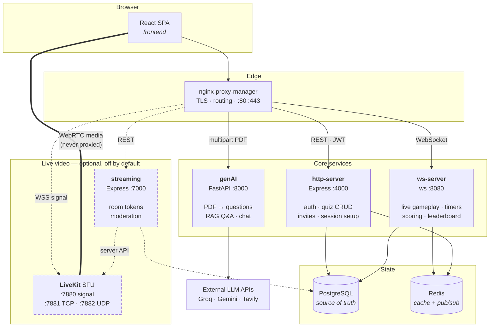
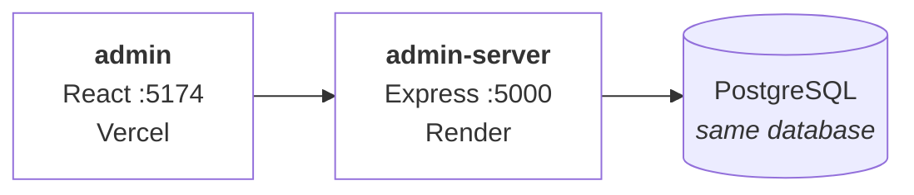
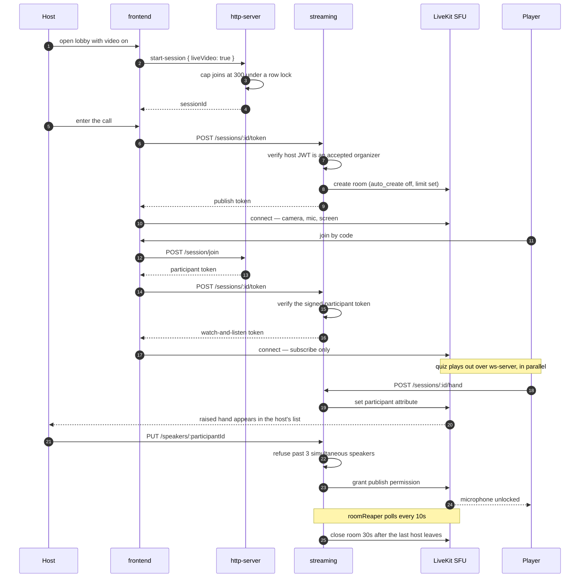
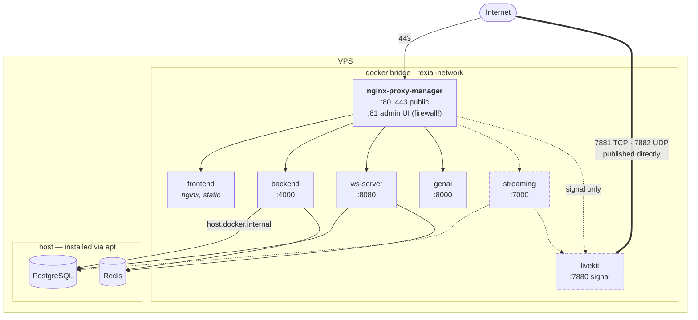

# Rexial Architecture

An in-depth look at how Rexial is put together: the services, how they talk to
each other, and why the boundaries fall where they do.

New here? Read [contribution.md](contribution.md) first to get the project
running, then come back for the *why*.

---

## Contents

- [The short version](#the-short-version)
- [System overview](#system-overview)
- [Why a monorepo](#why-a-monorepo)
- [The services](#the-services)
- [Data model](#data-model)
- [Flow 1: Creating a quiz](#flow-1-creating-a-quiz)
- [Flow 2: AI question generation](#flow-2-ai-question-generation)
- [Flow 3: Running a live quiz](#flow-3-running-a-live-quiz)
- [Flow 4: Running a quiz on camera](#flow-4-running-a-quiz-on-camera)
- [Caching and scale](#caching-and-scale)
- [Deployment topology](#deployment-topology)
- [Design decisions](#design-decisions)
- [Known limitations](#known-limitations)

---

## The short version

Rexial is a live quiz platform. A host builds a quiz, generates a join code,
and starts a session; participants join with that code and answer questions in
real time, scored on speed, with a live leaderboard.

It is split into **four services** in one monorepo, plus an optional fifth for
live video:

| Service | Stack | Port | Responsibility |
|---|---|---|---|
| `frontend` | React + Vite + Tailwind | 5173 | All UI |
| `http-server` | Express + Prisma | 4000 | Auth, CRUD, session setup |
| `ws-server` | `ws` + Redis | 8080 | Live gameplay, timers, scoring |
| `genAI` | FastAPI + LangChain | 8000 | AI question generation from PDFs |
| `streaming` *(optional)* | Express + LiveKit | 7000 | Live video rooms: who may join, speak, moderate |

Backed by **PostgreSQL** (source of truth) and **Redis** (hot cache + pub/sub).

---

## System overview

Everything a browser touches goes through one of these services. Two of them
— `streaming` and the LiveKit SFU behind it — only exist when live video is
switched on, which is why they are drawn apart from the rest.



Three things this diagram is trying to make obvious.

**Media does not go through nginx.** WebRTC cannot be reverse-proxied, so the
browser talks to LiveKit directly on 7881/7882 while every other connection
terminates at nginx. That one fact drives most of the live-video deployment
steps.

**`streaming` is not in the media path.** It issues tokens and relays the
host's moderation decisions through the LiveKit server API. Even at 300
cameras it stays a small Express app, because the video never touches it.

**The key split:** `http-server` owns everything *before* and *after* a quiz
runs. `ws-server` owns the quiz *while* it is running. They share a database
but never call each other — the handoff happens through the `QuizSession` row.

### The admin plane

Two more apps sit outside all of this and are deployed separately — not in
Docker, not in CI/CD:



`admin-server` reads the same Postgres that `http-server` writes. It is
read-only platform analytics for one super-admin: users, sessions, quizzes and
API traffic. See [apps/admin-server/README.md](apps/admin-server/README.md).

---

## Why a monorepo

Turborepo with pnpm workspaces:

```
Rexial/
├── apps/
│   ├── frontend/      React SPA
│   ├── http-server/   Express REST API
│   ├── ws-server/     WebSocket server
│   ├── genAI/         Python FastAPI service
│   ├── streaming/     LiveKit room tokens + moderation   (optional)
│   ├── admin/         Super-admin React panel            (deployed apart)
│   └── admin-server/  Super-admin API                    (deployed apart)
├── packages/
│   ├── db/            Prisma schema + generated client   (@repo/db)
│   ├── ui/            Shared components (scaffolded, not yet used)
│   ├── eslint-config/
│   └── typescript-config/
└── docker-compose.yml
```

The reason is `packages/db`. Both Node servers need identical database types;
publishing that to a registry for two consumers would be pure overhead. As a
workspace package, `@repo/db` is imported directly and a schema change surfaces
as a type error in both servers immediately.

`genAI` is in the workspace too, but only as a thin shim — its `package.json`
scripts shell out to Python so `pnpm dev` can start every service at once.
Its real dependencies live in `requirements.txt`.

---

## The services

### frontend — React SPA

Vite + React 19 + Tailwind 4, Zustand for auth state, React Router for routing.

Two API clients, deliberately separate:

| Client | Base URL | Timeout | Why |
|---|---|---|---|
| `api` | `VITE_API_URL` → :4000 | 10s | Normal CRUD; attaches JWT, logs out on 401 |
| `genaiApi` | `VITE_GENAI_URL` → :8000 | **120s** | LLM calls are slow; 10s would abort every request |

The WebSocket connection is opened directly by the `LiveQuiz` screen, not
through a client wrapper.

### http-server — Express REST API

Everything transactional. Routes under `/api/v1`:

```
/auth
  POST /register              bcrypt hash, returns JWT
  POST /login                 verify, returns JWT
  GET  /me                    [auth] current user
                              (Google OAuth via passport is also wired up)

/quizzes
  POST /                      [auth] create quiz
  GET  /                      [auth] list my quizzes
  GET  /:quizId               quiz + questions + answers
  POST /:quizId/generate-access-code    create the join code
  POST /:quizId/questions               add a question + its answers
  POST /:quizId/start-session [auth] create QuizSession -> returns sessionId

/quizzes (invites)
  POST /:quizId/invite        email a co-organizer
  POST /invite/accept/:token  [auth] accept

/sessions
  POST /join                  participant joins by code -> participantId
  GET  /:sessionId/leaderboard
```

Auth is a stateless JWT in the `Authorization` header. Participants are
deliberately **not** required to register — they get a `Participant` row tied to
a session, not a `User`.

### ws-server — live gameplay

A raw `ws` server. Every message is `{ type, payload }`.

**Client → server**

| Type | Sent by | Effect |
|---|---|---|
| `join` | both | Binds the socket to a session and role. An organizer must send their login `token`; the server checks it |
| `quiz:start` | organizer | Starts the quiz |
| `quiz:next-question` | organizer | Broadcasts the next question, starts its timer |
| `quiz:show-leaderboard` | organizer | Sends the standings now, once no question is open |
| `quiz:submit-answer` | participant | Scores the answer, updates the leaderboard |
| `quiz:end` | organizer | Ends the session |

**Server → client**

| Type | Meaning |
|---|---|
| `participants:sync` | Full participant list (sent on organizer join) |
| `error` | A message was refused, with a `code` such as `NOT_ORGANIZER`, `SESSION_MISMATCH` or `ORGANIZER_AUTH_FAILED` |
| `participant:joined` | Someone new joined the lobby |
| `quiz:start` | Quiz has begun |
| `quiz:question` | The current question — **answers stripped of `isCorrect`** |
| `quiz:timer-tick` | Countdown, once per second |
| `quiz:question-results` | Correct answer revealed after time expires |
| `quiz:leaderboard` | Updated standings |
| `quiz:ended` | Final results |

Two security-relevant details:

1. **Questions are sanitized before broadcast.** The `quiz:question` payload
   maps answers down to `{ id, text }` only. The client literally cannot know
   which option is correct, so you cannot cheat by reading the socket.
2. **Scoring happens server-side.** The server decides correctness and
   points, and measures the time used itself from the question's deadline in
   Redis. A `timeMs` in the message is ignored. Only an answer for the
   question that is currently open, received before its deadline, counts.
3. **The organizer role is decided by the server.** A `join` that asks for
   `ORGANIZER` must carry the host's JWT. The ws-server verifies it with the
   same `JWT_SECRET` as http-server and checks that the user is an accepted
   `QuizOrganizer` of the quiz behind the session. Otherwise it answers with an
   `error` message (`ORGANIZER_AUTH_FAILED`) and the socket stays out of the
   session. `quiz:start`, `quiz:next-question`, `quiz:show-leaderboard`,
   `quiz:end` and `participants:refresh` are only accepted from a verified
   organizer and only for the session that socket joined.

Scoring rewards speed:

```js
points = isCorrect ? Math.max(1, Math.ceil(10 * (1 - elapsedMs / limitMs))) : 0
```

`elapsedMs` is how much of the question's time limit had gone when the answer
reached the server. A correct answer scores 10 down to 1 across the time
limit. Wrong answers score nothing.

#### ws-server metrics

The ws-server serves Prometheus text format at `GET /metrics` on a separate
listener (port `9090` by default, configurable with `METRICS_PORT`). It binds
to `127.0.0.1` by default (`METRICS_HOST`); Docker Compose binds it to the
container network, but does not publish that port in production. In the
development Compose setup it is published only on host loopback:
`http://127.0.0.1:9090/metrics`. In production, scrape
`http://ws-server:9090/metrics` from an authorized container on the private
Compose network; do not proxy or publish this listener publicly.

Exposed metrics are aggregate, with no session or participant labels:
`rexial_ws_connections_open`, `rexial_ws_sessions_in_progress`,
`rexial_ws_answers_submitted_total`, `rexial_ws_answers_persisted_total`,
`rexial_ws_answer_queue_flush_failures_total`,
`rexial_ws_answer_queue_transaction_errors_total`, and the histogram
`rexial_ws_question_close_latency_seconds`. Submitted counts answers accepted
into the in-memory queue; persisted counts rows returned as inserted by the
database. Their difference is the current process-lifetime gap, and a rising
flush-failure or transaction-error counter indicates why it is growing.
Question-close latency covers timer-expired questions, from the timer deadline
to the results broadcast.

### genAI — AI question generation

FastAPI, isolated from the Node services so the Python AI dependency tree
(LangChain, ONNX Runtime) never touches them.

| Endpoint | Purpose |
|---|---|
| `POST /generate-quiz` | **Structured JSON** questions — what the UI uses |
| `POST /generate-questions` | Same, as a readable text blob |
| `POST /ask-pdf` | RAG question-answering over an uploaded PDF |
| `POST /chat` | General chat; routes to web search when needed |
| `GET /health` | Liveness, used by the container healthcheck |

Providers: **Groq** for question generation, **Gemini** for chat, **Tavily**
for web search, **fastembed** (`bge-small-en-v1.5` on ONNX Runtime, CPU only)
for embeddings.

All clients are built **lazily on first use**. Constructing them at import time
meant a missing API key crashed the whole service on startup — including
`/health`, which made the container fail its healthcheck and restart forever.

### streaming — live video (optional)

Runs a quiz on camera. Media goes through a self-hosted **LiveKit** server
(WebRTC SFU, written in Go); this service only issues room tokens and carries
out the host's moderation, so it is small and stays out of the media path.

- The host picks video when opening the lobby, which sets
  `QuizSession.liveVideo`. http-server then caps joins at **300**, counting
  under a row lock, and hands each player a signed participant token.
- Hosts get tokens that can publish camera, mic and screen. Players get
  watch-and-listen tokens; a host grants a player the mic through the LiveKit
  server API, and takes it back the same way.
- Rooms are created only by this service (LiveKit runs with `auto_create`
  off), with the participant limit set. The call outlives the quiz so the
  host can talk over the results; a 10-second check against Postgres closes
  a finished quiz's room 30 seconds after the last host leaves, when the
  host ends it, or an hour after the end. A running quiz's room is never
  closed this way, so a host reload mid-quiz is harmless.
- Off unless configured: without `VITE_STREAMING_URL` the frontend never
  offers it and never loads the LiveKit client.

Full details, the permission table and deployment steps:
[apps/streaming/README.md](apps/streaming/README.md).

---

## Data model

```
User ──┬──< Quiz ──┬──< Question ──< Answer
       │           │
       │           └──< QuizSession ──┬──< Participant ──< ParticipantAnswer
       │                              │                          │
       └──< QuizOrganizer             └──────────────────────────┘
            (co-hosts, invite flow)
```

| Model | Notes |
|---|---|
| `User` | Registered accounts. Hosts and co-organizers. |
| `Quiz` | Owned by a user. Holds `joinCode` and `QuizStatus`. |
| `QuizOrganizer` | Co-host link with `OrganizerRole` + `InviteStatus`. |
| `Question` / `Answer` | `Answer.isCorrect` is **never** sent to participants. |
| `QuizSession` | One live run of a quiz. Tracks `currentQuestionIndex`, `SessionStatus`. |
| `Participant` | A player in one session. **Not** a `User` — no signup needed. |
| `ParticipantAnswer` | One submission: answer, `timeMs`, `isCorrect`, `points`. |

`Quiz` is the template; `QuizSession` is one run of it. The same quiz can be
hosted repeatedly, each run with its own participants and leaderboard.

---

## Flow 1: Creating a quiz

```
Host                 frontend          http-server          PostgreSQL
 │                      │                   │                   │
 │ create quiz          │                   │                   │
 ├─────────────────────►│ POST /quizzes     │                   │
 │                      ├──────────────────►│ create Quiz       │
 │                      │                   ├──────────────────►│
 │                      │◄──────────────────┤ quizId            │
 │                      │                   │                   │
 │ add question ×N      │                   │                   │
 ├─────────────────────►│ POST /:id/questions                   │
 │                      ├──────────────────►│ Question + Answers│
 │                      │                   ├──────────────────►│
 │                      │                   │                   │
 │ generate join code   │                   │                   │
 ├─────────────────────►│ POST /:id/generate-access-code        │
 │                      ├──────────────────►│ joinCode, ACTIVE  │
 │                      │◄──────────────────┤                   │
 │  "ABC123"            │                   │                   │
 │                      │                   │                   │
 │ host live            │                   │                   │
 ├─────────────────────►│ POST /:id/start-session               │
 │                      ├──────────────────►│ create QuizSession│
 │                      │◄──────────────────┤ sessionId         │
 │                      │                                       │
 │                      └──► navigate to /quiz/manage/:sessionId
 │                           (from here, ws-server takes over)
```

---

## Flow 2: AI question generation

```
Host            frontend           genAI                Groq
 │                 │                  │                   │
 │ upload PDF      │                  │                   │
 │ + "5 questions  │                  │                   │
 │   on chapter 2" │                  │                   │
 ├────────────────►│                  │                   │
 │                 │ POST /generate-quiz (multipart)      │
 │                 ├─────────────────►│                   │
 │                 │                  │ save_upload()     │
 │                 │                  │ ↳ sanitize name   │
 │                 │                  │                   │
 │                 │                  │ PyPDFLoader       │
 │                 │                  │ ↳ chunk 3000/300  │
 │                 │                  │ ↳ whole PDF as    │
 │                 │                  │   context (no     │
 │                 │                  │   retrieval here) │
 │                 │                  │                   │
 │                 │                  │ prompt + context  │
 │                 │                  ├──────────────────►│
 │                 │                  │◄──────────────────┤ JSON
 │                 │                  │                   │
 │                 │                  │ _extract_json()   │
 │                 │                  │ ↳ strip fences    │
 │                 │                  │ validate:         │
 │                 │                  │  • exactly 4 opts │
 │                 │                  │  • exactly 1 true │
 │                 │                  │  • drop the rest  │
 │                 │◄─────────────────┤ questions[]       │
 │                 │                  │                   │
 │◄────────────────┤ review panel     │                   │
 │                 │                  │                   │
 │ edit / deselect │                  │                   │
 │ then "Add to Quiz"                 │                   │
 ├────────────────►│                  │                   │
 │                 │ POST /quizzes/:id/questions  ×N      │
 │                 ├──────────────────────────────► http-server
```

**Generation does not use retrieval.** Worth being precise, because the service
is described as "RAG" overall: `/generate-quiz` chunks the PDF and passes the
**entire** text as context, since questions should cover the whole document.
Only `/ask-pdf` does true RAG — it embeds chunks into a vector store and
retrieves the top 5 matches for the question. So the embedding model is never
loaded during quiz generation.

Two more things worth noting.

**The model is not trusted.** Its output is parsed defensively (`_extract_json`
handles markdown fences and chatty preambles) and then validated. Any question
without exactly 4 options and exactly 1 correct answer is **discarded**. A
malformed question is dropped rather than shown to the host or saved.

**The human is the last gate.** Generated questions land in a review panel.
Nothing is written to the database until the host confirms.

---

## Flow 3: Running a live quiz

```
Organizer          ws-server          Redis        PostgreSQL      Participants
    │                  │                 │              │               │
    │ join (ORGANIZER) │                 │              │               │
    ├─────────────────►│ getCachedSession│              │               │
    │                  ├────────────────►│ miss         │               │
    │                  │                 ├─────────────►│               │
    │◄─────────────────┤ participants:sync              │               │
    │                  │                 │              │               │
    │                  │◄───────────────────────────────────────────────┤ join
    │◄─────────────────┤ participant:joined ────────────────────────────►│
    │                  │                 │              │               │
    │ quiz:start       │                 │              │               │
    ├─────────────────►│                 │              │               │
    │◄─────────────────┤ quiz:start ────────────────────────────────────►│
    │                  │                 │              │               │
    │ quiz:next-question                 │              │               │
    ├─────────────────►│ strip isCorrect │              │               │
    │◄─────────────────┤ quiz:question ─────────────────────────────────►│
    │                  │ startQuestionTimer             │               │
    │◄─────────────────┤ quiz:timer-tick (1/sec) ──────────────────────►│
    │                  │                 │              │               │
    │                  │◄───────────────────────────────────────────────┤ submit
    │                  │ score it        │              │               │  answer
    │                  │ points = 10..1  │              │               │
    │                  │  scaled by speed│              │               │
    │                  │ enqueueAnswer() │              │               │
    │                  ├────────────────►│ buffer       │               │
    │                  │                 │              │               │
    │                  │ ...every 250ms or 200 answers: │               │
    │                  ├────────────────────────────────►│ createMany
    │                  │                 │              │               │
    │                  │ timer expires   │              │               │
    │                  │ flushSession()  │              │               │
    │                  ├────────────────────────────────►│ (drain buffer)
    │◄─────────────────┤ quiz:question-results ────────────────────────►│
    │◄─────────────────┤ quiz:leaderboard ─────────────────────────────►│
    │                  │                 │              │               │
    │ quiz:end         │                 │              │               │
    ├─────────────────►│ clearSessionCache              │               │
    │◄─────────────────┤ quiz:ended ───────────────────────────────────►│
```

The organizer drives the pace — questions advance on `quiz:next-question`, not
automatically. Timers live in `timeManager.ts`, keyed per session.

---

## Flow 4: Running a quiz on camera

Live video runs *alongside* the quiz, not inside it. The ws-server knows
nothing about cameras, and the streaming service knows nothing about scores.
The only thing joining them is `QuizSession.liveVideo` and the session id used
as the room name.



**Why the player's own id proves nothing.** Participant ids are visible to
everyone in the lobby and on the leaderboard. A request carrying only an id
could be forged by any viewer, so `streaming` accepts only the *signed*
participant token that `http-server` issued at join. The same rule is why
hosts must present their login JWT and be an accepted `QuizOrganizer`.

**Why rooms outlive the quiz.** The final leaderboard is when a host says a
few words about the results, so the call carries on after `quiz:ended`. The
reaper closes a finished quiz's room 30 seconds after the last host leaves,
when the host ends it explicitly, or an hour after the end — whichever comes
first. A *running* quiz's room is never reaped, so a host reloading mid-quiz
does not hang up on everyone.

**Limits worth knowing:** 300 participants per room, 20 extra host seats, and
at most 3 players holding the floor at once. The 300 is enforced twice — by
`http-server` when joining, and by the room's own participant limit as a
backstop.

---

## Caching and scale

### Redis as a cache

Hot session state is cached so a 50-player session does not hammer Postgres on
every answer:

| Key | Holds |
|---|---|
| `quiz:session:${sessionId}` | Session + quiz metadata |
| `quiz:questions:${sessionId}` | Questions with answers |
| `quiz:participant:${participantId}` | Participant record |
| `quiz:leaderboard:${sessionId}` | Current standings |

Writes go to Postgres and invalidate the relevant key
(`invalidateParticipants`, `invalidateLeaderboard`). `clearSessionCache` wipes
everything when a session ends. Postgres stays the source of truth; Redis is
never authoritative.

### Redis pub/sub for horizontal scale

This is the part that makes `ws-server` scalable, and it is easy to miss.

A WebSocket connection is pinned to one process. With two `ws-server`
instances behind a load balancer, an organizer on instance A and a participant
on instance B would never see each other's events.

`broadcastToSession` solves it by doing two things at once:

```js
// 1. deliver to sockets on THIS instance
for (const client of clients) { ...client.ws.send(...) }

// 2. publish to every OTHER instance
pub.publish(sessionChannel(sessionId), envelope)
```

Each instance subscribes to `session:*` and relays what it receives to its own
clients. The envelope carries a `_sid` (a per-process UUID), and the subscriber
**drops messages it published itself** — otherwise local clients would receive
every event twice.

```
   instance A                  Redis                  instance B
  ┌──────────┐                                       ┌──────────┐
  │ organizer│──broadcast──┬──► local sockets        │          │
  └──────────┘             │                         │          │
                           └──► publish session:X ──►│ relay ──►│ participant
                                                     └──────────┘
                            (A ignores its own _sid)
```

So the WS tier can scale horizontally today. The compose file runs a single
instance, but nothing in the code assumes that.

---

## Deployment topology

One VPS. Docker Compose runs the services; **PostgreSQL and Redis are not in
Docker** — they are installed on the host with `apt` and reached through
`host.docker.internal`, which Compose maps to the bridge gateway. There is no
`db` service to `depends_on`.



Only nginx and the two LiveKit media ports are exposed. Everything else is
reachable solely inside the Docker network.

| Published port | Service | Why it cannot hide behind nginx |
|---|---|---|
| 80 / 443 | nginx | The entry point itself |
| 81 | nginx admin UI | **Firewall this to trusted IPs** |
| 7881 | LiveKit (TCP) | WebRTC media; fallback for UDP-blocked networks |
| 7882 | LiveKit (UDP) | WebRTC media; the normal path |

> **Warning:** port **81** is the nginx-proxy-manager admin UI. Anyone who
> reaches it can re-route your traffic.

### Turning live video on

`streaming` and `livekit` sit behind a Compose profile, so a normal deploy
never starts them:

```bash
# in the deploy directory's .env
COMPOSE_PROFILES=streaming
LIVEKIT_KEYS=<key>: <secret>
```

Without `VITE_STREAMING_URL` the frontend never offers video and never loads
the LiveKit client, so the feature is genuinely absent rather than merely
hidden. Full steps: [apps/streaming/README.md](apps/streaming/README.md).

LiveKit deliberately gets **only** `LIVEKIT_KEYS` from the environment, never
`.env.prod` — it also reads `REDIS_HOST`, and seeing the backend's Redis there
it switches to multi-node mode and fails to start.

### Images and migrations

Images are built by GitHub Actions and tagged `:latest` **and**
`:<commit-sha>`; the deploy pins the SHA so rollback is exact. CD only runs
after CI has passed for that same commit. See
[.github/CI-CD.md](.github/CI-CD.md).

Migrations are applied by the `backend` container on startup, not by the
deploy job:

```
db:generate:prod && db:migrate && start
```

---

## Design decisions

**Why split HTTP and WebSocket servers?**
Different scaling shapes. REST traffic is bursty and stateless; WS connections
are long-lived and stateful. Splitting lets you run many WS instances during a
big quiz without over-provisioning the REST tier.

**Why is the AI service Python and separate?**
The libraries that matter (LangChain, fastembed) are Python-only.
Isolating them keeps the ML dependency tree out of the Node images, lets the
service scale independently, and means an LLM outage degrades one feature rather
than taking down the platform.

**Why do participants not need accounts?**
Signup is the biggest drop-off in a classroom or event. A `Participant` row
belongs to a session, not a user. Registering later is optional and only needed
to see past history.

**Why cache in Redis instead of in process memory?**
In-process cache breaks the moment you run two instances — and the same Redis
is already needed for pub/sub.

**Why is scoring server-side?**
It is the only place it can be trusted. The client never learns which answer is
correct until results are revealed.

---

## Known limitations

Honest list of what is not solved yet.

| Area | Limitation |
|---|---|
| **Join codes** | Generation has a race condition — two concurrent requests can collide (tracked in [issues.md](issues.md) #1) |
| **AI vector store** | `InMemoryVectorStore` is rebuilt per request; no caching, so the same PDF is re-embedded every time (#5) |
| **AI cost** | No rate limiting or per-user quota on generation endpoints |
| **Deploys** | `docker compose up -d` recreates containers — brief downtime, no rolling update |
| **Environments** | No staging; `main` deploys straight to production |
| **Test coverage** | ~29 test files across five services run in CI, but coverage is uneven — the ws-server gameplay path is the best covered, the frontend the thinnest |
| **Live video** | No TURN/TLS yet, so players on networks that block UDP 7882 and TCP 7881 get the quiz without the video |
| **Frontend lint** | ~20 pre-existing eslint errors; the CI lint step reports without blocking (#6) |
