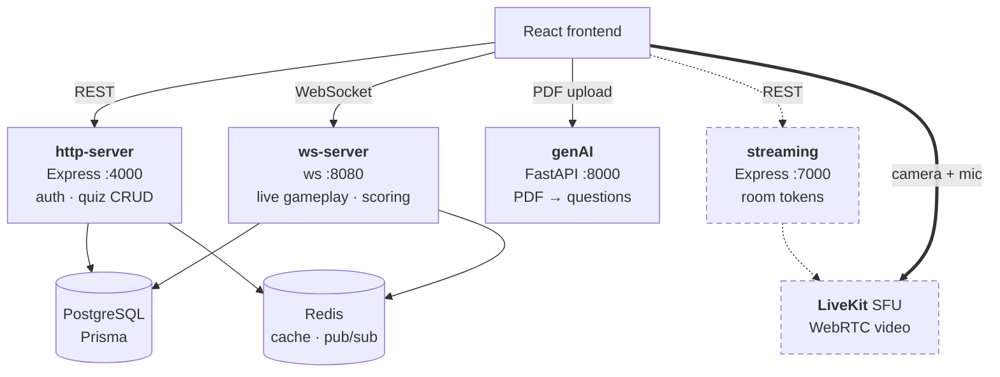

<div align="center">

# Rexial

**An open-source real-time quiz platform — host a live quiz, share a code, watch the leaderboard move as people answer.**

[](https://github.com/TheCodeHeist-Coder/Rexial/actions/workflows/ci.yml)
[](LICENSE)
[](CONTRIBUTING.md)
[](https://github.com/TheCodeHeist-Coder/Rexial/issues?q=is%3Aissue+is%3Aopen+label%3A%22good+first+issue%22)

[Demo](assets/versio1-video/demo.mp4) · [Architecture](ARCHITECTURE.md) · [Setup](setup.md) · [Contributing](CONTRIBUTING.md) · [Good first issues](https://github.com/TheCodeHeist-Coder/Rexial/issues?q=is%3Aissue+is%3Aopen+label%3A%22good+first+issue%22)

</div>

---

A host builds a quiz, Rexial generates a join code, and participants join from any
device without signing up. Questions advance in real time over WebSockets, scores
update after every question, and a final leaderboard closes the session.

Hosts can also upload a PDF and let the AI service write the questions for them.

## A look at it

<div align="center">

**The host opens a lobby and shares the code**


**Participants answer on their own device, and the room watches the answers land**


**Scores settle into a leaderboard at the end**


</div>

> The screenshots are from a load test, which is why the players are named
> Bot1, Bot2 and so on — 751 of them in one session.

## Why it might interest you

Rexial is a genuinely distributed real-time system, not a CRUD app with a quiz theme.
If you want to work on any of the following, there is real code here to work on:

- **WebSockets at scale** — a dedicated `ws-server` handles live quiz sessions. Recent
  work took p99 latency from 466ms to ~9ms for thousands of concurrent users.
- **Retrieval-augmented generation** — a Python/FastAPI service chunks and embeds PDFs,
  then generates validated multiple-choice questions.
- **WebRTC at the edge** — a self-hosted LiveKit SFU carries live video for up to 300
  players, with a small Express service issuing tokens and handling moderation.
- **Monorepo architecture** — Turborepo + pnpm workspaces across five services and a
  shared Prisma package.
- **Deployment** — Docker Compose for dev and prod, GitHub Actions CI, Jenkins, nginx.

## Features

**Live quizzes (v1, shipped)**
- Create and host quizzes, with co-host support via email invite
- Participants join with a code — no account required
- Real-time question flow over WebSockets
- Live dashboard after each question, final leaderboard at the end
- Random avatar per participant

**AI quiz generation (v2, shipped)**
- Upload a PDF and describe what you want (*"5 medium questions about chapter 2"*)
- Questions land in a review step — edit, fix, or drop them before anything is saved
- Model output is validated: anything without exactly 4 options and 1 correct answer
  is discarded rather than shown

**Live video quizzes (v3, in progress)**
- The host and co-hosts run the quiz on camera; players watch and listen
- Players appear only as their avatar, raise a hand, and speak once a host lets them in
- Up to 300 players per live video session
- Optional: self-hosted [LiveKit](https://livekit.io) over WebRTC, off unless you configure it — see [apps/streaming](apps/streaming/README.md)

## Architecture



Live video (`streaming` + LiveKit) is optional and off unless configured.

| Service | Stack | Port |
|---|---|---|
| `apps/frontend` | React | 5173 |
| `apps/http-server` | Node + Express | 4000 |
| `apps/ws-server` | WebSockets | 8080 |
| `apps/genAI` | Python + FastAPI | 8000 |
| `apps/streaming` | Node + Express, LiveKit (optional) | 7000 |
| `packages/db` | Prisma + PostgreSQL | 5432 |
| `apps/admin` | React (super-admin panel) | 5174 |
| `apps/admin-server` | Node + Express (admin API) | 5000 |

The super-admin panel is optional and deployed separately, not through Docker or
CI/CD — see [apps/admin-server/README.md](apps/admin-server/README.md).

**[Read the full architecture guide →](ARCHITECTURE.md)** — service boundaries, data
model, request flows, caching, and the reasoning behind each decision.

## Quick start

**Prerequisites:** Node.js ≥ 22, pnpm ≥ 9, Docker, Docker Compose (Python ≥ 3.11 only
if you are working on the AI service).

```bash
git clone https://github.com/TheCodeHeist-Coder/Rexial.git
cd Rexial
pnpm install
```

Create the environment files — the exact values are in [setup.md](setup.md):

```bash
cp apps/genAI/.env.example apps/genAI/.env   # AI keys are optional
```

Then start everything:

```bash
docker compose up --build
```

The frontend comes up at **http://localhost:5173**.

> The AI features need free API keys from [Groq](https://console.groq.com/keys),
> [Google AI Studio](https://aistudio.google.com/apikey) and [Tavily](https://tavily.com).
> Without them the rest of the app still runs — only the AI endpoints return an error
> naming the missing key.

Full walkthrough, including running without Docker: **[setup.md](setup.md)**

## Contributing

Contributions are welcome, and the issue tracker is organised so you can find
something that matches how much time you have.

- **New to the project?** → [good first issues](https://github.com/TheCodeHeist-Coder/Rexial/issues?q=is%3Aissue+is%3Aopen+label%3A%22good+first+issue%22)
  are scoped to a few files and say exactly which ones.
- **Want something meatier?** → [help wanted](https://github.com/TheCodeHeist-Coder/Rexial/issues?q=is%3Aissue+is%3Aopen+label%3A%22help+wanted%22)
  covers race conditions, RAG caching, and WebSocket scaling.

[CONTRIBUTING.md](CONTRIBUTING.md) is a step-by-step guide written for a first-ever
pull request — fork, branch, env setup, commit conventions, and opening the PR.

Please also read our [Code of Conduct](CODE_OF_CONDUCT.md). To report a security
issue, see [SECURITY.md](SECURITY.md) — do not open a public issue.

## Roadmap

See **[ROADMAP.md](ROADMAP.md)** for what is shipped, in progress, and open for
contribution.

## License

[MIT](LICENSE) — free to use, modify and distribute.
